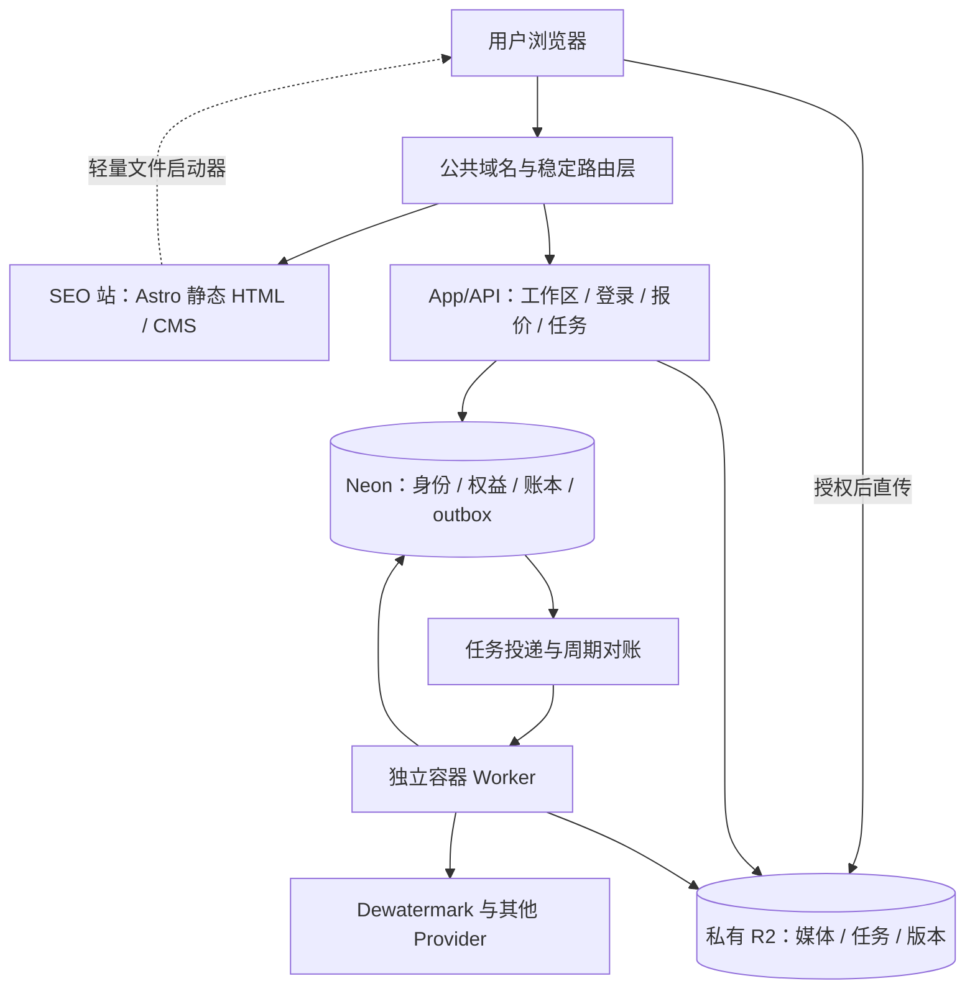

# AI Watermark 开发方案：功能与 SEO 独立架构

版本：2026-10-24，架构决策与实施约束。依据：[图片、视频产品规划与交互设计](PROCESSING_PRODUCT_DESIGN.md)。当前实现、真实测试、迁移和发布门禁统一记录在 [IMPLEMENTATION_TODO](IMPLEMENTATION_TODO.md)。文中初始调研结论标明为基线，不代表当前仍未实施；本文也不以设计或本地测试代替生产验收。

## 1. 建议采用的方案

功能与 SEO 应独立演进。建议保留一个正式仓库，形成两个可独立构建、发布和回滚的 Web 产物，以及一个独立异步 Worker。公开入口先保持同域，SEO 已有 URL 保持稳定。路由层单独治理，避免 CMS 发布改变工作区路由。

| 边界 | 首期目标 | 长期演进 |
| --- | --- | --- |
| SEO 与功能代码 | 从模板中移出完整编辑器和业务实现，保留轻量入口 | 分别按内容需求和产品需求发展 |
| 构建与发布 | SEO 与 App/API 两套产物，独立部署目标 | 必要时进一步拆 App 前端与 API |
| 处理运行时 | 独立容器 Worker，负责媒体检查和供应商处理 | 图片/视频按资源与队列需求独立扩容 |
| Git 仓库 | 同仓，多模块，便于契约与设计系统协作 | 出现独立团队、访问权限或交付要求时再拆仓 |
| 公共 URL | 主域 SEO 路由 + 同域 `/app/*`、`/api/*` | 需要浏览器安全隔离或多客户端接入时评估 `app.`/API 域名 |
| 数据 | 私有 R2 保存媒体与 MVP 任务状态；Neon 保存身份、权益、金融账本和必要协调元数据 | 持久历史、团队与复杂查询出现后另立数据迁移决策 |

“同仓库”“同域名”“同一部署”是三项不同决策。只做目录重构而继续整站一次发布，只能实现模块分层，不能宣称 SEO 已可独立发布。反过来，独立部署也不要求先拆域名或 Git 仓库。

Google 对子目录和子域没有索引、排名偏好；本方案优先同域，是为了降低当前登录与文件交接的迁移成本。[Google FAQ](https://developers.google.com/search/help/crawling-index-faq?hl=en)

## 2. 初始调研基线与当时需要解决的问题

初始只读调研核实了 canonical checkout，origin 为 `https://github.com/teddy920810/ai-watermark-remover.git`，基线为 `main @ 5be42381e32623186ce06dc3dcc6618bae85ebd5`，当时保留了 10 个既有工作区改动。该调研阶段没有编辑产品代码；随后已进入独立 worktree 的实施阶段，当前状态以 [实施清单](IMPLEMENTATION_TODO.md) 为准。

| 调研时事实 | 当时影响 |
| --- | --- |
| Astro 使用 server output + Vercel adapter，但首页、工具落地页、Blog、robots、sitemap 已 prerender | SEO 正文已有静态基础，无需重写内容站 |
| 首页和工具模板直接导入 uploader，布局包含登录/签到 React island | 内容模板与业务交互仍耦合，需缩小为启动器和客户端身份显示 |
| SEO 页面、API、供应商配置共用构建和部署 | CMS 内容发布也会重新构建同一个应用；需要拆发布单元 |
| 图片 Provider 在创建任务请求中同步等待结果 | 无法据此承诺关页继续、视频长任务或服务重启恢复 |
| R2 job store 只有 get/save，无条件覆盖 | 多 Worker、重试和对账需要版本、条件写入及执行权控制 |
| Neon 免费余额上限 3，每个任务固定 ±1 | PRO、精修、视频不能只改按钮数字，必须扩展报价与可变金额预留 |
| 视频页面标 Coming Soon，模板可能回落到图片上传器 | 需要明确媒体类型、操作 ID 与真实可用性，不能让内容字段替代能力开关 |
| OAuth popup、API fetch 均按当前 origin 工作 | 直接迁移 app 子域会影响登录、消息回传和 CORS |

主要代码依据：`astro.config.mjs:18`、`src/pages/index.astro:18`、`src/components/LandingPage.astro:2`、`src/layouts/SiteLayout.astro:112`、`src/lib/jobs/job-service.ts:64`、`src/lib/jobs/r2-job-store.ts:12`、`src/lib/benefits/postgres-benefit-store.ts:84`、`src/components/uploader/ImageUploader.tsx:125`。行号为本次检查时位置。

## 3. 方案比较与取舍

| 方案 | 优点 | 主要代价 | 判断 |
| --- | --- | --- | --- |
| 继续单应用、单部署 | 改动少，现有登录自然复用 | 内容与功能发布绑在一起，长任务仍需另外解决 | 只适合过渡，不作为长期目标 |
| 同仓、SEO/App 独立部署、同域路由、独立 Worker | 保留现有 SEO URL，发布和计算资源分开，契约容易协作 | 多一个稳定路由层，需处理资源前缀与文件交接 | 推荐目标 |
| SEO 主域 + app 子域 | 浏览器 origin 可分开，应用和内容权限更容易隔离 | 现有 OAuth/草稿/API/CORS 需要设计迁移 | 保留为后续选项 |
| 多仓库、多子域、多个业务微服务 | 团队和权限隔离明确 | 当前阶段增加版本、联调和运维成本 | 有实际组织或规模需求后采用 |

隔离范围要如实描述：独立发布可以避免内容更新替换处理代码，但仍共享公共网关、云平台和数据服务。单域不同路径不构成浏览器安全隔离；SEO 中的脚本与 App 处于同一 origin，必须遵守同样的脚本与内容安全要求。

## 4. 目标架构与部署单元



当前选定的首发部署安排：

- SEO：独立 Vercel 项目，最终生成纯静态内容，不持有 R2、供应商或数据库密钥。
- App/API：复用原 `ai-watermark-remover` Vercel 项目及其生产域名和既有密钥，改为构建 App 产物；Astro 页面壳 + React 工作区岛，服务端处理认证、上传授权、报价和任务查询。它与 SEO 项目分别发布，不迁移现有登录会话密钥。新 `ai-watermark-app` 项目仅作验证环境，不放生产密钥。
- Worker：Node/TypeScript 跨平台代码，使用固定版本媒体工具的容器，建议部署 Cloud Run Jobs。图片、视频、媒体探测先共用代码和镜像，使用不同执行配置与并发预算。
- 路由：首发由原 App 项目的 Build Output 静态路由承担轻量网关。`APP_SITE_ORIGIN` 指向独立 SEO 项目部署后已确认的固定生产 `vercel.app` alias；新 Site 项目采用官方 Standard Protection，使生产固定来源提供公开静态内容，preview 和唯一部署地址继续受保护。不为自动化关闭保护、不改变原 App 项目的保护设置。首发不依赖 DNS 操作，内容自定义子域可日后选用。公开页面和 SEO 资源外部转发，应用、API、认证与业务资源留在本地。剥离发往 SEO 的 Cookie/Authorization 和来自 SEO 的 Set-Cookie；私有 noindex 不施加到公开代理响应。单独的第三网关项目保留为可选演进，模板必须先渲染为真实来源地址。
- 投递：首期使用 Neon 金融事务 outbox 加投递器；API 成功写事务后尝试快速触发 Worker，周期调度补偿漏投递。周期调度与 Worker 分别鉴权，不开放公共任意任务执行。

Vercel 支持通过外部 rewrites 在同一个公共域名组合多个来源。[Vercel 路由文档](https://vercel.com/docs/routing/rewrites) Cloud Run Jobs 适合运行容器任务并在完成后退出；具体内存、磁盘、任务时间和启动延迟应按样本测试配置。[Cloud Run Jobs](https://docs.cloud.google.com/run/docs/create-jobs)

初始调研时尚未核实 GCP 账号、区域、额度和预算；当前已选择独立 Cloud Run Jobs Worker，权限、构建、部署及验收进度见 [实施清单](IMPLEMENTATION_TODO.md) 和 [Worker 部署说明](WORKER_DEPLOYMENT.md)。不把普通 `waitUntil` 当作任务持久化机制，首期不同时叠加多套消息队列与工作流平台。Web 构建及首发路由的实际配置见 [独立部署说明](../../apps/DEPLOYMENT_TARGETS.md)。

## 5. 路由、缓存与登录边界

| 公共路径 | 归属 | 渲染 / 缓存 / 索引 |
| --- | --- | --- |
| `/`、现有图片/视频工具 slug、`/blog/*`、法律页面 | SEO | 静态 HTML，公开缓存，按内容策略索引 |
| `/app/image`、`/app/video` | App | 工作区壳与 React 岛；noindex，不进 sitemap |
| `/app/jobs/*`、`/app/account` | App | 认证与归属校验；私有响应 no-store、noindex |
| `/api/*` | App/API | 保留现有路由兼容层，新接口采用版本；私有接口不缓存 |
| `/auth/popup` 及现有认证回跳路径 | App | 保持既有同源消息校验；不由 SEO 站生成 |
| `/_site-assets/*` | SEO | 版本化公开资源，可长期缓存 |
| `/_app-assets/*` | App | 独立版本化资源，可长期缓存；保留仍被已打开页面引用的版本 |
| 未知公开 URL | SEO / 网关 | 真实 404，不能统一重写成工作区或首页 |

路径为目标建议，不能为了目录统一随意重命名现有已收录页面。`/app` 匹配必须有路径边界，不能误匹配 `/application` 等内容 slug。静态站和 App 的构建资源使用独立前缀；只分 HTML 路由而不分资源路径，会在独立发版时造成冲突。

路由层保持公共 origin，认证配置、OAuth callback 和 popup 的消息来源仍按公共域名验证。反向代理需正确传递 Cookie、Set-Cookie、状态码和允许的来源信息；后端只信任受控网关设置的转发头，内部部署地址不成为公开登录入口。Cookie 属性变更另作认证改动测试，不顺手扩大到整个父域。

SEO 来源不需要用户 Cookie、Authorization 或改写认证 Cookie 的能力；路由配置应剥离不必要的身份信息。API、认证、报价、任务与私有下载响应显式禁止共享缓存，并验证网关没有覆盖。Vercel 外部 rewrites 可能遵循上游缓存头，因此缓存边界必须有测试。[缓存规则](https://vercel.com/docs/routing/rewrites#caching-rewrites-to-external-origins)

若后续采用 app 子域，默认让用户在 App 登录，SEO 只做公开展示与入口；不要默认共享父域 Cookie。那时重新设计本地草稿交接、OAuth、消息来源和 R2 CORS。已有 `X-Frame-Options: DENY`，本方案不采用 iframe 嵌入工作区。

## 6. 代码与依赖边界

首期保留现有 SEO 内容目录，避免为整理文件夹同时迁移全部 CMS 路径。建议结构：

```text
src/                         现有 Astro SEO 页面、内容与轻量入口
public/                      公开运营素材与示例
apps/site/                   SEO 独立构建配置与路由发现容器
apps/app/                    App/API 独立构建配置与路由发现容器
apps/worker/                 媒体检查、处理、恢复、投递/对账命令
apps/gateway/                可选第三网关的模板及安全默认配置
packages/contracts/          API schema、操作 ID、状态与能力类型
packages/domain/             无框架依赖的状态、报价、额度规则
packages/editor/             React 编辑器、画布、时间轴与版本 UI
packages/launcher/           轻量选择文件、本地校验与草稿交接
packages/design-system/      品牌 token 和纯展示组件
packages/provider-adapters/  仅服务端 Provider 适配
```

边界规则：SEO 只能依赖公共契约、轻量启动器和展示组件；不能依赖 Provider、数据库客户端或完整任务编排。编辑器通过 API client 使用功能，不 import SEO 内容记录。domain 不依赖 Astro、Vercel 或 Windows。运行时环境变量只在部署单元入口读取，通过构造参数注入，解决当前服务组装对 `astro:env/server` 的依赖。

共享 packages 是源码协作方式，不等于每次都一起发布。发布时记录各产物 SHA、契约版本、资源版本和兼容范围；独立部署引用已锁定的构建产物。先保持 API 向后兼容，再更新客户端，最后删除旧协议。CMS 内容更新不自动升级工作区 SDK 或触发数据库迁移。

不以 URL、SEO slug 或文件扩展名直接决定供应商。建议稳定操作 ID 为：图片普通自动、图片 PRO、图片精修、视频去水印；现有背景移除和物体移除继续保留独立操作。具体字符串与版本在契约阶段确定，并兼容现有 operation 值。

## 7. CMS、SEO 内容与产品能力如何连接

SEO 负责“为什么用、适合什么、如何开始”；功能负责“当前能做什么、如何执行、如何收费”。两边通过少量稳定数据连接：

| 数据 | 权威来源 | 允许谁修改 |
| --- | --- | --- |
| 标题、摘要、示例说明、步骤、FAQ、内链 | Astro 内容集合 / Pages CMS | 内容编辑 |
| slug、canonical、索引策略、语言关系 | 内容模型与 SEO 校验规则 | 经校验的内容变更 |
| 工具页到 operationId / preset 的映射 | 受校验的工具目录 | 开发维护；CMS 只能选择已定义项 |
| 媒体类型、文件限制、精修支持、价格规则 | 版本化能力契约与后端 | 产品/开发发布 |
| 实时可用性、维护、供应商余额保护 | `/api/v1/capabilities` 等服务能力接口 | 功能系统 |
| 用户任务、结果、余额 | App/API | 认证和归属校验后的用户操作 |

SEO 构建使用无密钥的公开能力快照检查内容声明，不调用真实供应商或读取用户数据库。上传入口加载后再读取实时可用性：服务临时不可用时，页面正文和教程仍正常显示，按钮提供明确反馈。API 不可用不能令整张 SEO 页面渲染失败。

CMS 的 Coming Soon 文案不负责开启 API。多张 SEO 落地页可以对应同一个处理操作，例如 logo/text 等用途页不需要各自复制一套编辑器和后端。不同落地页仍要有真实差异的示例、说明和 FAQ，不能仅替换关键词批量生成重复内容。

后续可公开的能力声明要和已验证能力绑定。精修、视频仍未通过契约或真实结果验证时，内容不能独立宣称已开放；这一限制通过构建校验与服务开关共同执行。

## 8. 落地页选文件后如何进入独立工作区

用户仍可在初始页直接选择文件，不先面对登录墙。轻量启动器负责选择、本地基础校验与短期草稿，完整画布、时间轴、任务和费用确认在 App 中完成。

推荐同源交接：

1. 在 SEO 页选择 File/Blob，生成随机 draftId，将文件、设置、来源工具与草稿版本写入 IndexedDB。
2. 当前标签页的 sessionStorage 只保存 draftId 指针，然后进入同域 `/app/image` 或 `/app/video`。
3. App 恢复草稿并显示本地预览；到本站上传阶段再登录，OAuth 往返后继续恢复。
4. 上传并确认服务端已封存文件后，删除本地媒体草稿。取消、退出账号或草稿到期也触发清理。
5. 本地空间不足、隐私模式、存储被淘汰时明确提示并允许到工作区重新选择；不无提示跳转造成文件丢失。

IndexedDB 可以存储文件/Blob，但受同源和浏览器配额限制。[IndexedDB 文档](https://developer.mozilla.org/en-US/docs/Web/API/IndexedDB_API) 不将文件内容、Base64 或签名地址写入 URL/localStorage，也不把 `blob:` URL 当作跨导航可靠存储。大视频需要测量写入延迟与空间占用；不承诺所有设备都能持久缓存。

草稿仅供短期交接，建议默认一小时逻辑有效期，具体值在产品验收时确认。读取时拒绝过期草稿，并在启动或访问时清理；关闭浏览器时不能保证准点物理删除，不自动请求永久存储权限。同源的 CMS/第三方脚本与 App 共享浏览器信任边界，因此应限制任意 HTML/脚本进入内容、保持依赖和 CSP 管理。若以后需要隔离内容编辑带来的脚本风险，采用独立 app origin，并将选文件动作迁到 App，重新设计入口体验。

这是对前一份交互方案的技术落实：选择文件后发生同域路由切换，Header、品牌和草稿连续，完整工作区在 App 呈现。初始页的示例仍可在独立演示模式查看。

公开正文保留完整 HTML 和真实链接。首屏上传器可 `client:load`；下方对比增强可 `client:visible`；完整编辑器只在 App 加载。一个编辑任务尽量由同一个 React 根管理，避免把画布、工具栏、时间轴拆成不能共享 Context 的多个孤岛。[Astro 指令](https://docs.astro.build/en/reference/directives-reference/)、[跨岛状态](https://docs.astro.build/en/recipes/sharing-state-islands/)

## 9. 功能 API 与产物契约

新工作区使用版本化契约，下面是职责草案，不是已经新增的接口：

| 接口职责 | 必要内容 |
| --- | --- |
| capabilities | 当前操作、输入限制、支持模式、契约版本；不泄露供应商余额或密钥 |
| 创建/完成上传 | owner、受控对象 key、类型/体积限制、分片授权、完整性校验 |
| 准备媒体 | 封存输入，异步检查真实尺寸、时长、帧率、编码与 mask；不调用收费 Provider |
| 生成报价 | 绑定输入版本、选区、操作、服务端媒体信息、价格版本、额度单位和有效期 |
| 创建操作 | quoteId、clientOperationKey；确认后原子预留并可靠投递，快速返回本站操作 ID |
| 查询/列出任务 | 仅返回本账号任务；阶段、真实进度、额度状态、可用动作和产物信息 |
| 创建精修/重做 | 绑定父产物和 mask；新操作、新报价，保留上一成功版本 |
| 下载/续签 | 校验归属、产物 ready 与期限；返回短期本站下载授权 |

`clientOperationKey` 绑定 owner 与请求内容摘要；同一个 key 内容不同时应冲突，不悄悄创建第二次收费。媒体检查与供应商处理要分开：上传成功不等于格式兼容，供应商完成不等于结果已可下载。

任务模型至少需要 schemaVersion、ownerId、operationId、输入/选区引用与版本、父产物、报价/预留引用、stage、attemptId、leaseEpoch、providerJobId/session、进度来源、错误类别、结果列表及过期时间。供应商字段只在服务端保存，公共响应使用本站统一语义。

产物记录实际 MIME、尺寸、视频时长/帧率/音轨、字节数、版本和可用期限。输出 JPG、精修分辨率变化与视频音轨必须按实际文件显示。不能仅根据请求参数假设结果属性。

现有 `/api/jobs` 等接口先保留兼容适配，不把新协议直接覆盖旧响应。是否能复用现有 processing 轮询必须由当前客户端契约测试证明；所有新工作区只走新协议，避免双路径同时发起处理。

## 10. 可靠任务与异步执行

### 权威状态与投递

遵守当前项目规则：媒体、结果和 MVP 任务状态保存在私有 R2。Neon 新增的内容仅用于身份/金融事务、去重和投递协调，不能把完整 job 文档悄悄迁入 SQL。

报价前先执行不收费的 `preflight/probe` 内部动作：完成上传后，创建 R2 检查任务和耐久投递记录，Worker 校验上传归属与准入、封存文件并探测实际属性。该路径只受上传/资源配额控制，不预留处理额度，不允许调用收费 Provider。检查完成后才能生成处理报价。下述金融准入顺序仅适用于用户确认的收费处理动作。

建议写入顺序：

1. 完整上传后把输入从浏览器可写的 staging key 封存到不可由浏览器覆盖的 input key，再检查内容并绑定报价。旧上传签名尚未过期也不能修改已报价输入。
2. R2 使用唯一 jobId 和仅首次创建条件写入 prepared manifest，绑定不可变输入、报价和请求摘要。
3. Neon 同一事务建立额度预留和 outbox，唯一约束保证一个用户操作只有一次金融准入。
4. 提交成功后尝试触发 Worker；失败由 outbox 投递器补偿。投递是否已确认不是供应商处理是否已完成。
5. 收费处理 Worker 检查金融准入与 R2 manifest，取得执行权后推进状态；重复投递读取检查点，不重建收费操作。内部 preflight Worker 仅检查上传准入，不能借此绕过处理收费。
6. 结果完整、检查通过并持久化 R2 后才幂等结算，随后写 ready。结算已成功而 ready 写入失败时由对账修复。

prepared 孤儿、重复 manifest 与漏投递要有清理/对账路径。操作准入与 outbox 属于 SQL 原子事务；R2 与 SQL 之间没有跨系统事务，必须通过上述顺序、幂等和恢复处理，不宣称两者天然原子。

R2 当前 S3 API 明确支持原子的 PutObject 条件写入，适合实现 ETag 比较后更新；现有普通 save 不满足该要求。[R2 S3 条件操作](https://developers.cloudflare.com/r2/api/s3/api/) JobStore 应新增 create-if-absent、read-with-version 和 compare-and-swap，并在并发测试中验证冲突结果。

### 执行与重试

状态主线：PREPARED → QUEUED → VALIDATING / TRANSFERRING → SUBMITTING → PROCESSING → SAVING → SETTLING → READY。未知请求为 UNKNOWN；确定失败进入 FAILED 与额度退回流程。用户措辞沿用产品规划，不直接展示内部状态码。

- 执行租约和递增 epoch 防止旧 Worker 覆盖新状态；所有状态更新使用 R2 条件写入。
- 调用收费接口前先持久化 SUBMITTING + attemptId。网络无响应或进程退出后，新 Worker 不因为租约过期就再次提交。
- 可以保证本站账本按操作幂等；供应商未公开幂等能力，不能保证上游恰好执行一次。租约无法撤销已在途的 HTTP 请求。
- 图片接口同步返回、无远程查询契约：未知结果先对账。迟到响应保存为 attempt 的不可变产物，由协调器决定认领，不由失租 Worker直接覆盖当前状态。
- 视频已有 providerJobId 时可查询该任务，轮询间隔和超时按供应商要求与实际测试配置；不重复创建供应商任务。
- 媒体检查、已知任务查询、结果取回、R2 保存和账本补状态可安全重试；收费提交未知、供应商上传覆盖语义未确认时不能通用自动重试。
- 配置指数退避、最大尝试、死信/告警与周期对账。平台整任务自动重跑不能直接重做收费步骤，初始配置应由应用检查点控制。

首期不另买消息中间件：outbox 是耐久投递协调记录，支持 dueAt、尝试、投递租约、执行引用、nextCheckAt 和 dead-letter 状态。Cloud Run 接受执行请求不代表容器已经启动或成功执行；协调记录需保留到 R2 业务任务终态及关联金融操作结清，检查漏投递、已接受未启动、早退和失租。执行引用与检查计划属于协调元数据，不能替代 R2 的 Provider 状态与进度。周期调度唤醒补偿器，不能仅用一次进程内 Promise。Cloud Run 支持通过 API 执行任务，Cloud Scheduler 支持分钟级调度；调度只做恢复与投递，不定时创建新的收费处理。[执行任务](https://docs.cloud.google.com/run/docs/execute/jobs)、[调度格式](https://docs.cloud.google.com/scheduler/docs/configuring/cron-job-schedules)

初期可一操作一容器执行，后续根据实测启动时间和空等成本拆短检查点/轮询或增加常驻消费者。设置图片、视频各自的并发与成本上限，不能让视频占满所有图片执行配额。新增 Vercel Queues/Workflow 等平台时替换投递适配器，不改用户操作和金融契约。

## 11. 数据、额度与留存

| 数据 | 首期权威位置 | 说明 |
| --- | --- | --- |
| 原件、mask、封存输入、结果与各版本 | 私有 R2 | 归属、实际属性、保留时间明确 |
| 业务任务状态与供应商检查点 | 私有 R2 | CAS、版本、租约；对外状态读取以此为准 |
| 身份、现有免费次数、预留、扣退账本 | Neon | 事务与唯一约束，保留已有账户权益 |
| 新价格表、金融报价与准入去重、outbox | Neon | 新增 ADR 明确字段、事务、期限；支持金融动作与不收费 preflight 的投递协调，不存媒体或完整 job |
| 近期任务列表定位 | R2 的 owner 前缀下索引对象 | 初期分页定位后读取权威 job，再校验归属；不全桶扫描 |
| 本地未上传草稿 | IndexedDB | 短期使用，不作为任务或云端文件权威来源 |

金融单位分开处理：现有免费次数继续服务原有共享操作规则，不直接换算成视频秒数。新 PRO、精修和视频采用可变金额报价，以整数最小单位记录，明确额度来源、价格版本、预留、成功结算与失败退回。供应商 credits 仅用于成本核算，不等于本站用户余额。

当前数据库的 ±1 和余额上限 3 需要通过兼容迁移扩展，不能修改老余额含义或因奖励上限吞掉预留退款。支付购买属于另一个业务范围；本方案只预留账本与定价接口，不自动选择支付渠道或实现订阅。

UNKNOWN 的额度不能无限冻结。当前实现采用 24 小时逻辑冻结期限，到期对账时由本站归还预留额度，迟到结果不再次自动扣费；供应商退款与本站用户退回分别记录。耐久投递和周期对账必须运行，才能实际执行期限。临时投递失败保持 pending 并退避，不因十次失败自动丢弃账务恢复任务。

保留期按对象角色管理：上传 staging、封存输入、运行中任务和已完成结果不能共用无差别 24 小时删除规则。运行中任务及恢复必需输入暂缓清理；结果从 ready 后按本站政策计算可用期限，超长期运行有上限和告警。现有 1 天生命周期迁移需明确核对，不把 UI 截止时间写成生命周期无法兑现的保证。

长期若增加永久历史、批量项目、团队或复杂搜索，建议另立 ADR，把可查询任务/产物索引放 Postgres；是否迁移任务主状态需同时修改当前项目约束并经过数据兼容验证。媒体仍留私有对象存储，金融账本不随临时任务过期删除。

## 12. 图片与视频的实施边界

| 功能 | 实现重点 | 开放条件 |
| --- | --- | --- |
| 初始落地页 | 独立图片/视频内容、轻量入口、示例模式、错误反馈与关闭状态 | 入口与能力开关匹配，手机首屏能操作 |
| 图片普通自动 | 迁入可靠任务，沿用现有 Dewatermark 适配，真实输出元数据 | 旧能力回归、异常与下载通过 |
| 图片精修 | mask 契约、会话保存、父版本与新版本、精修独立报价 | 6000/1920 尺寸冲突、mask 编码/黑白语义、会话组合完成验证 |
| 图片 PRO | 独立模式与价格，验证实际输出 | 实际账户权限、扣费和效果通过；不默认开放 PRO 后续精修 |
| 视频 | R2 授权上传、跨平台媒体 probe、静态 mask、供应商四步流程、后台查询、结果入库 | MP4/24fps/≤9 分钟和体积/编码边界、音轨、实际费用验证 |
| 结果与任务恢复 | 版本不覆盖、同步对比、续签、过期状态、短期任务列表 | 真实结果可播放/下载，跨账号隔离 |

视频原文件不通过 Vercel Function 请求体转发；浏览器授权直传 R2，Worker 负责向供应商传输和取回结果。Vercel 当前函数请求/响应体上限为 4.5MB，控制 API 只传小型元数据。[Functions 限制](https://vercel.com/docs/functions/limitations#request-body-size) 图片 Provider 返回的 Base64 也由 Worker 消化，不通过浏览器 API 返回整份结果。

媒体工具以固定版本容器运行，输入为本地受控文件或授权对象，使用参数数组调用、限制 CPU/内存/磁盘与超时。首期不自动转码，不承诺动态水印追踪、免费试片、取消供应商处理或无损保留。供应商文档冲突沿用前一份调研清单，不作为已解决项。

## 13. SEO 技术方案与长期内容扩展

公开页面的 H1、正文、示例、步骤、FAQ、真实链接与 metadata 在原始 HTML 中存在。不能依赖登录、IndexedDB、点击上传或 API 返回才生成正文；Google 的 JS 渲染有额外限制。[Google JS SEO](https://developers.google.com/search/docs/crawling-indexing/javascript/javascript-seo-basics)

| 类型 | 策略 |
| --- | --- |
| 首页与真正独立的工具用途页 | 保留公开路径，独立内容与自引用 canonical |
| 教程与 Blog | 静态生成，按主题组织内链，不与任务数据混合 |
| 图片/视频编辑器与账户、历史 | noindex，不进 sitemap；私有内容仍靠认证和归属校验 |
| 参数与来源追踪 | 不创建新的可索引副本，canonical 指向对应规范公开页 |
| 暂未开放但有实际参考价值的页面 | 诚实说明状态；是否索引由内容价值决定，不因 Coming Soon 自动通过或排除 |
| 草稿、近重复、无实质内容页 | 不发布或按策略 noindex，不进入 sitemap |
| 旧 URL 必须变更 | 一对一永久重定向，更新内部链接、canonical、sitemap并监控 |

`robots.txt` 禁止抓取不等于不索引；依赖 noindex 的公开工作区壳应允许爬虫读到该声明。不能把所有 App 页 canonical 到首页替代 noindex。sitemap只列预期索引的规范公开 URL；沿用现有自建生成器，增加显式索引规则，不为了方案更换插件。[noindex](https://developers.google.com/search/docs/crawling-indexing/block-indexing)、[canonical](https://developers.google.com/search/docs/crawling-indexing/consolidate-duplicate-urls)

功能 API、供应商异常、用户余额和实时进度不成为 SEO 构建依赖。页面更新时间仅随实际内容变化更新，不因用户任务完成或每次部署统一刷新。结构化数据根据真实页面类型生成，不虚构评分、免费价格或已开放功能。

长期多语言按 locale 内容集合与稳定路由发展，在有独立翻译内容后增加 hreflang、语言 sitemap 和对应 canonical。新增处理功能先新增 operation/capability，再由内容团队决定是否需要新用途页；新增 SEO 关键词页不自动新建后端操作。

主域与公开路径迁移应与功能拆分分开做。确需迁移时按 Google 指南建立映射和长期保留重定向，不将所有旧页指向首页，也不同时更换域名、CMS 与设计。[Google 迁移指南](https://developers.google.com/search/docs/crawling-indexing/site-move-with-url-changes)

## 14. 开发批次与验收顺序

以下按依赖划分批次，不给未实测的人天或完成日期。每批应有独立可审查变更与退出条件。

| 批次 | 交付 | 依赖与开放条件 |
| --- | --- | --- |
| P0 契约确认 | 操作/能力表、API v1草案、状态机、数据 ADR、报价单位；并行安排供应商最小样本 | 共享接口和数据边界收敛后可进入P1/P2；图片、视频样本分别门控P3/P4对应能力的真实开放，真实样本先明确预算 |
| P1 边界与发布基础 | contracts/domain/launcher拆分；SEO 与 App 独立构建；同域路由、资源前缀、登录与草稿交接 | SEO 与 App 能独立发布/回滚；文件与OAuth恢复；公开URL不变 |
| P2 可靠任务与金融基础 | 不收费preflight、R2 CAS、outbox、Worker、封存输入、幂等预留/结算/退回、对账 | 先用Mock与故障注入证明重投、已投递未启动、进程中断、未知请求与入库失败可恢复；旧权益不变 |
| P3 图片完整体验 | 初始页、普通处理、对比、精修/PRO按验证结果开放、版本与下载 | 桌面/手机真实操作、输出、扣退与恢复通过 |
| P4 视频完整体验 | 视频初始页、上传检查、固定区域、报价、异步状态、对比/下载 | 一次授权真实端到端视频样本通过；成本、音轨、过期语义明确 |
| P5 SEO/CMS 联动与发布验收 | 内容能力对齐、索引规则、示例替换、站点/功能各自门禁、运行手册 | 所有改动URL与代表模板通过；按范围生产验收与回滚演练 |

如果图片、视频样本与契约未解决，可继续完成无付费调用的模块拆分、Mock 状态、协议测试、静态页面与工作区联调；未解决的操作保持关闭。设计稿中尚未选择的视觉细节不会阻碍状态、接口和后端基础方案，但真正实现页面前应先收敛视觉目标。

## 15. 测试、CI 与独立发布证明

行为变化先定向红测，再最小实现与定向绿测。架构、API、鉴权、R2、Provider、依赖与 CI 变化适用本地 `release:verify`；低风险内容/UI 按现有规则选一个最小充分门禁，不叠加重复全套检查。

CI 继续保留 `npm run verify` 作为合并 main 的必需门禁。可以改成聚合各模块验证，但不能靠拆目录绕过现有 required check。验证范围与部署目标分开：CMS 内容 PR 即使完成全量验证，也只发布 SEO；Worker 与 App 只在各自代码/依赖契约变更时发布，数据库迁移显式执行。

| 验收面 | 必须证明的行为 |
| --- | --- |
| SEO 独立 | 无 App/API/Neon/Provider 连接仍能构建、打开公开正文；JS 关闭仍有内容和入口链接 |
| 发布独立 | SEO 发布/回滚期间，旧 App 页面、在途任务、登录与下载继续可用；App 发布不要求重建内容 |
| 资源兼容 | 旧 HTML/已打开 App 引用的资源仍能加载；资源前缀、契约版本和路由回滚一致 |
| 输入与权限 | 跨账号不能操作文件/任务；已封存输入不能被旧上传签名修改；mask版本和报价绑定 |
| 金融 | 重复点击、回调、多标签页、消息重投只准入一次；退款不受免费奖励上限吞减 |
| 恢复 | 模拟各持久化边界宕机，能补投递、取回结果或进入UNKNOWN，不能盲目重发收费请求 |
| 产品 | 图片精修失败保留旧版本，视频播放同步，下载续签、真实文件和到期行为正确 |
| SEO 索引 | canonical、sitemap、noindex、404和内链一致；工作区/私有任务不进入公开sitemap |

Mock 和故障注入覆盖边界；真实 Provider 小样用于证明合同、质量与账单，不循环消耗额度。新操作发布后按项目规则各做对应的一次手动真实功能烟测；定时烟测继续 public-only，不周期调用收费 Provider。网关/域名/认证迁移发生时，公开 smoke、OAuth 和认证功能链路分别验证。

独立部署不等于无风险：共享网关路由、公共域名和数据变更仍需专项验证。采用 expand/contract 数据迁移，先加字段并兼容旧客户端，等待旧任务和客户端退出后再删旧字段。Worker 镜像及任务 schema 记录版本，在途任务按兼容处理器恢复，不能要求重新收费处理。

## 16. 长期拆分条件与需要决定的事项

| 触发信号 | 下一项技术演进 |
| --- | --- |
| 需要 CMS 与产品的浏览器安全边界、独立权限团队 | App 子域、App 专属登录与入口体验；不是为了排名拆域名 |
| API被桌面端、移动端或合作方直接使用 | App前端与API独立部署，保持身份和权益权威来源单一 |
| 视频持续占用内存/磁盘/并发，影响图片 | 分离 Worker执行池或服务，不拆金融账本 |
| 任务量使 outbox 轮询/投递延迟不达标 | 引入专用耐久队列/工作流，保留 outbox 与幂等检查点 |
| 需要永久历史、团队、批处理、复杂查询 | 查询索引与任务数据ADR；媒体保持R2，账本长期保留 |
| 团队、访问权限与发布责任确实独立 | 再拆 Git 仓库；公共契约与设计系统用版本化包发布 |

初始调研提出的准入决策已在实施阶段收敛：所有账号可见新操作，processingCredits 默认零并由管理员分配；普通图片优先沿用现有免费次数；UNKNOWN 默认 24 小时逻辑冻结；执行平台采用 Cloud Run Jobs。实际定价版本、授权调用预算、供应商小样结果及仍待确认事项见 [实施清单](IMPLEMENTATION_TODO.md)。密钥和账号资料通过安全配置进入服务端，不在聊天中提交。

Codex 可继续完成的工作：接口/数据 ADR、工程拆分、测试、Mock 联调、产品实现、SEO/CMS同步及已授权范围内的发布准备。购买、云账号计费开通、供应商书面确认和真实调用预算不由本方案自动授权。

“仅开发方案、不编辑代码、未执行发布”是初始调研阶段的边界记录。后续实现和平台操作的实际完成状态统一见 [IMPLEMENTATION_TODO](IMPLEMENTATION_TODO.md)，仓库/PR、部署、DNS/证书、OAuth 与生产烟测分别验收，不由本文推断为已通过。
